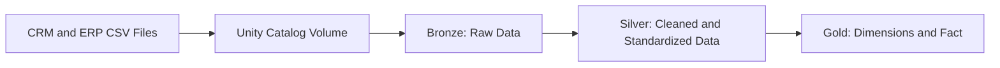
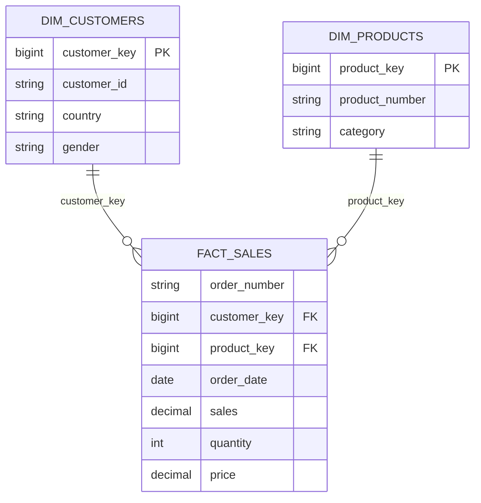

# Databricks Lakehouse Data Engineering Project

This project builds a small Databricks lakehouse using CRM and ERP data in CSV format. The data is ingested into the **Bronze** layer, cleaned and standardized in the **Silver** layer, and then modeled into dimension and fact tables in the **Gold** layer for analytical use.

## Data Architecture



The project uses Unity Catalog with the following objects:

- Catalog: `workspace`
- Bronze schema: `workspace.bronze`
- Silver schema: `workspace.silver`
- Gold schema: `workspace.gold`
- Source volume: `workspace.bronze.raw_sources`
- Storage format: Delta Lake

## Project Structure

```text
databricks_project/
├── datasets/
│   ├── source_crm/
│   └── source_erp/
└── script/
    ├── init_lakehouse.ipynb
    ├── bronze/
    ├── silver/
    │   ├── crm/
    │   ├── erp/
    │   └── silver_orchestration.ipynb
    └── gold/
        ├── gold_dim_customers.ipynb
        ├── gold_dim_products.ipynb
        ├── gold_fact_sales.ipynb
        └── gold_orchestration.ipynb
```

## Source Data

### CRM

| File | Data | Row Count |
|---|---|---:|
| `cust_info.csv` | Customer information | 18,494 |
| `prd_info.csv` | Product information | 397 |
| `sales_details.csv` | Sales order details | 60,398 |

### ERP

| File | Data | Row Count |
|---|---|---:|
| `CUST_AZ12.csv` | ERP customer information | 18,484 |
| `LOC_A101.csv` | Customer location and country | 18,484 |
| `PX_CAT_G1V2.csv` | Product categories | 37 |

The files must be placed in the volume using the following structure:

```text
/Volumes/workspace/bronze/raw_sources/
├── source_crm/
│   ├── cust_info.csv
│   ├── prd_info.csv
│   └── sales_details.csv
└── source_erp/
    ├── CUST_AZ12.csv
    ├── LOC_A101.csv
    └── PX_CAT_G1V2.csv
```

## Medallion Architecture Processing Workflow

### 1. Initialize the lakehouse

Run `script/init_lakehouse.ipynb` to:

- Select the `workspace` catalog.
- Create the `bronze`, `silver`, and `gold` schemas.
- Create the `workspace.bronze.raw_sources` volume.

Then upload all CSV files from the `datasets` directory into the volume, preserving the original file and directory names.

### 2. Bronze — Raw Data

The project provides two Bronze notebooks:

- `script/bronze/bronze_layer.ipynb`: uses centralized configuration and a loop to ingest the files.

Both notebooks read CSV files with headers, infer schemas, and overwrite Delta tables. The Bronze layer does not perform business transformations or data standardization.

| Source File | Bronze Table |
|---|---|
| `source_crm/cust_info.csv` | `workspace.bronze.crm_cust_info` |
| `source_crm/prd_info.csv` | `workspace.bronze.crm_prd_info` |
| `source_crm/sales_details.csv` | `workspace.bronze.crm_sales_details` |
| `source_erp/CUST_AZ12.csv` | `workspace.bronze.erp_cust_az12` |
| `source_erp/LOC_A101.csv` | `workspace.bronze.erp_loc_a101` |
| `source_erp/PX_CAT_G1V2.csv` | `workspace.bronze.erp_px_cat_g1v2` |

Run only one of the two Bronze notebooks because both overwrite the same target tables.

### 3. Silver — Clean Data

Run `script/silver/silver_orchestration.ipynb`. The orchestration notebook executes the following six notebooks sequentially:

1. CRM customers: creates `workspace.silver.crm_customers`.
2. CRM products: creates `workspace.silver.crm_products`.
3. CRM sales: creates `workspace.silver.crm_sales`.
4. ERP customers: creates `workspace.silver.erp_customers`.
5. ERP customer locations: creates `workspace.silver.erp_customer_location`.
6. ERP product categories: creates `workspace.silver.erp_product_category`.

The main transformations include:

- Trimming whitespace and standardizing string values, gender codes, and marital-status codes.
- Removing or handling missing values in key fields.
- Splitting the CRM product key into category ID and product number.
- Standardizing cost, product line, and date fields.
- Converting CRM dates in `yyyyMMdd` format to date values.
- Recalculating price when it is missing or invalid.
- Removing the `NAS` prefix and `-` characters from ERP customer IDs.
- Standardizing ERP birth dates, countries, and gender values.
- Converting ERP maintenance-status values to Boolean values.

All Silver tables are written in overwrite mode as Delta tables.

### 4. Gold — Analytical Data Model

Run `script/gold/gold_orchestration.ipynb`. The Gold orchestration creates the tables in dependency order:

1. `gold_dim_customers`
2. `gold_dim_products`
3. `gold_fact_sales`

#### Customer Dimension

The `workspace.gold.dim_customers` table:

- Combines CRM customer, ERP customer, and ERP location data.
- Prefers CRM gender and uses ERP gender as a fallback.
- Creates the `customer_key` surrogate key using `ROW_NUMBER()` ordered by `customer_id`.

#### Product Dimension

The `workspace.gold.dim_products` table:

- Combines CRM product data with ERP product-category data using category ID.
- Creates the `product_key` surrogate key using `ROW_NUMBER()` ordered by start date and product number.
- Contains category, subcategory, maintenance, product-line, and validity-date information.

Note: the filter for historical product records using `end_date IS NULL` is currently commented out, so the dimension currently includes all product records.

#### Sales Fact

The `workspace.gold.fact_sales` table:

- Uses CRM sales as the fact source.
- Joins sales data with the customer and product dimensions using business keys.
- Contains order number, customer key, product key, order/ship/due dates, sales, quantity, and price.



## End-to-End Execution

1. Open a Databricks workspace and import the `databricks_project` directory.
2. Run `script/init_lakehouse.ipynb` to create the catalog objects.
3. In Catalog, navigate to `workspace → bronze → raw_sources` and upload the CSV files:
   - CRM files into `source_crm`.
   - ERP files into `source_erp`.
4. Run `script/bronze/bronze_layer.ipynb` or the basic Bronze notebook.
5. Run `script/silver/silver_orchestration.ipynb`.
6. Run `script/gold/gold_orchestration.ipynb`.
7. Validate the results using SQL:

```sql
SELECT * FROM workspace.gold.dim_customers LIMIT 100;
SELECT * FROM workspace.gold.dim_products LIMIT 100;
SELECT * FROM workspace.gold.fact_sales LIMIT 100;
```

## Notes and Limitations

- The project does not include a Bronze orchestration notebook or a complete Databricks Workflow/Job. The current workflow is primarily run manually in the defined order.
- `init_lakehouse.ipynb` must run first to set the active catalog to `workspace` and create the schemas and volume.
- The Gold notebooks depend on the required Silver tables having been created successfully.
- Surrogate keys are generated with `ROW_NUMBER()`, so key values may change when source data changes.
- Unmatched CRM and ERP records can cause incomplete dimension joins or missing dimension keys in the fact table.